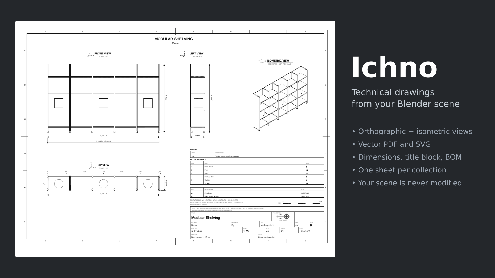
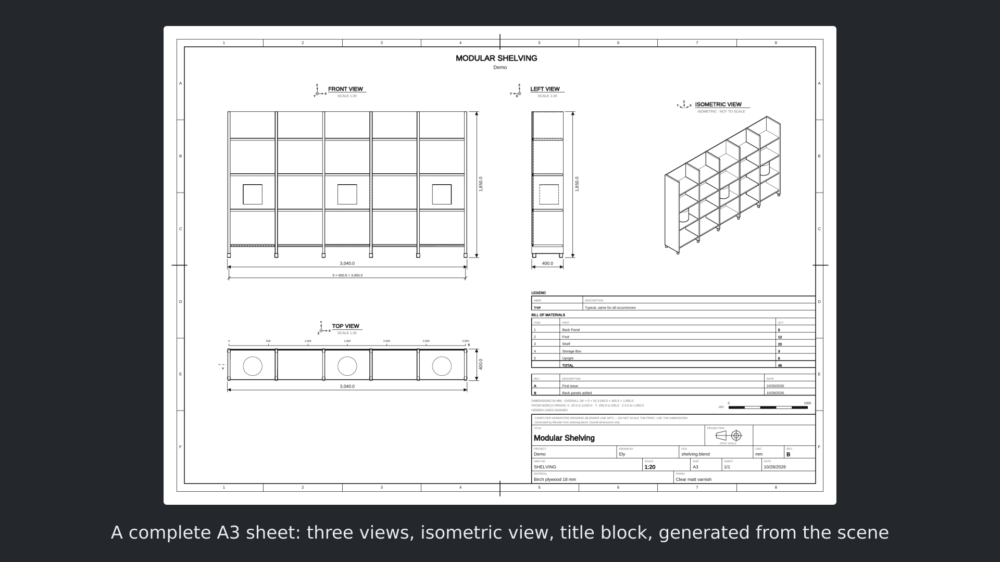
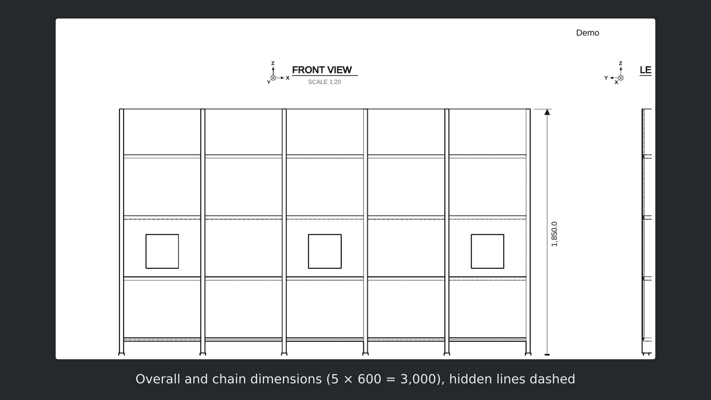
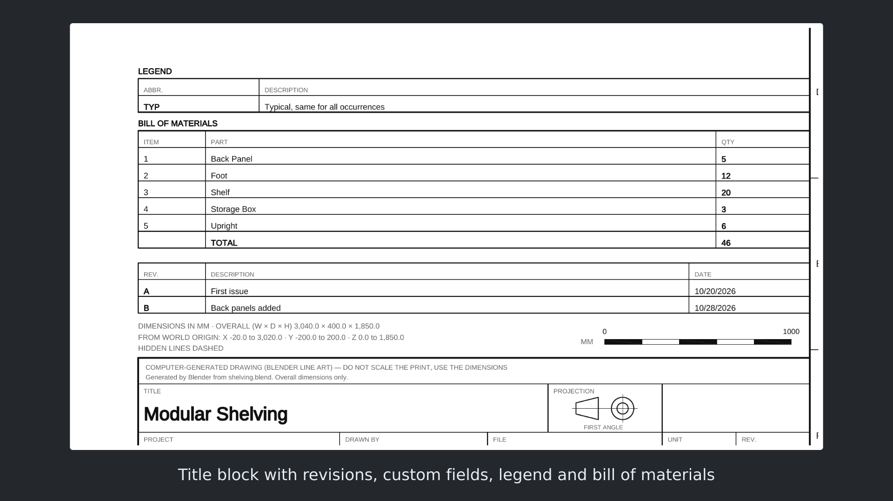
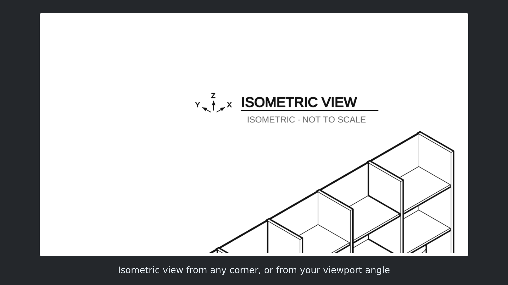

# Ichno — technical drawings for Blender

**Free Blender add-on: turn your 3D scene into a technical drawing in one click.**
Orthographic views, isometric view, dimensions, title block and bill of materials, exported as vector **PDF** and **SVG**.

Ichno makes **blueprints and shop drawings** straight from Blender: furniture and woodworking plans, interior layouts,
product and 3D printing parts, mechanical assemblies. The drawings are ready to print, to send to a client or a workshop,
or to open in Illustrator, Inkscape, Affinity or a CAD tool.

## Install
- **Recommended:** Blender ‣ Edit ‣ Preferences ‣ Get Extensions, search for **Ichno**.
- Or download the zip from [Releases](../../releases) and use *Install from Disk*.

Requires Blender 4.3 or newer (tested up to 5.2). Windows, macOS and Linux.

## Quick start
1. 3D Viewport ‣ Sidebar (N) ‣ **Ichno** tab.
2. Choose what to draw: visible objects, selection or one collection.
3. Click **Make Plan**. The PDF opens when it's done.

The drawing is computed by a second Blender in the background, from a copy of your file:
**your scene is never modified**, you can keep working, and you can cancel at any time.

## Features

### Orthographic and isometric views
- Front, side and top views, **first-angle (ISO E) or third-angle (ISO A) projection**
- Isometric view from any corner, or from your current viewport angle
- Clean visible lines from Line Art, optional dashed hidden lines, three line weights
- Automatic standard scale (metric or imperial), or a fixed one

### Dimensions
- Overall dimensions on every view, in mm, cm, m or inches
- Dual dimensioning, e.g. `254.0 [10.00"]`
- Chain dimensions for rows of objects, equal spacing combined as `5 × 600 = 3000`
- Coordinate ruler or architect grid (A, B, C / 1, 2, 3)

### Sheets, title block and bill of materials
- A4 to A0, Letter, Tabloid, ANSI C and D, portrait or landscape
- **One sheet per collection** in a single multi-page PDF, each with its own views and scale
- Title block with company name and logo, drawing number, author, date, revision table, custom fields
- **Bill of materials (BOM)** counted by object name, collection or custom property
- Abbreviation legend, remarks and ownership notice

### Practical
- Linked and instanced collections drawn and counted as one part
- Fast mode for drafts of heavy models
- Interface and drawings in English and French

| | |
|---|---|
|  |  |
|  |  |

## FAQ
**Can I open the drawing in AutoCAD or another CAD tool?**
Yes, through the SVG or PDF export (most CAD tools import one of them).

**Does it modify my scene?**
No. Ichno works on a temporary copy of your file, in a second Blender running in the background.

**Does it work with heavy models?**
Yes. Models with millions of triangles take a few minutes; use Fast mode for drafts, or one sheet per sub-assembly.

## Bugs and ideas
Open an [issue](../../issues), with your Blender version and, if possible, a small .blend file.

## License
GPL-3.0-or-later, see [LICENSE](LICENSE).
